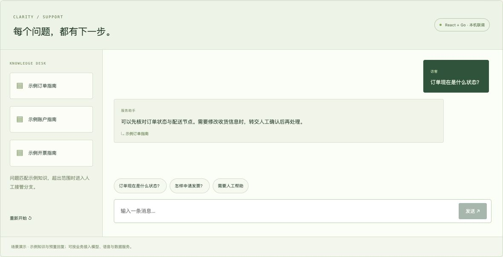
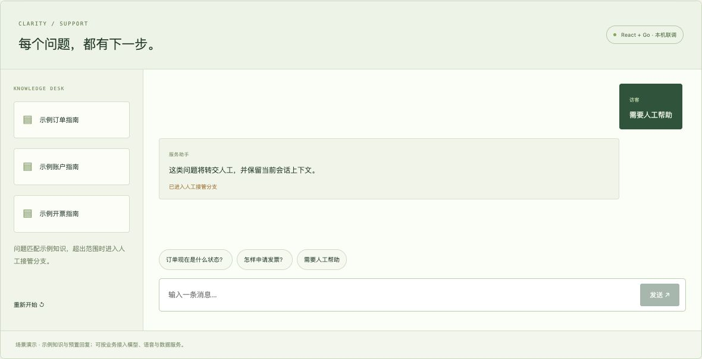
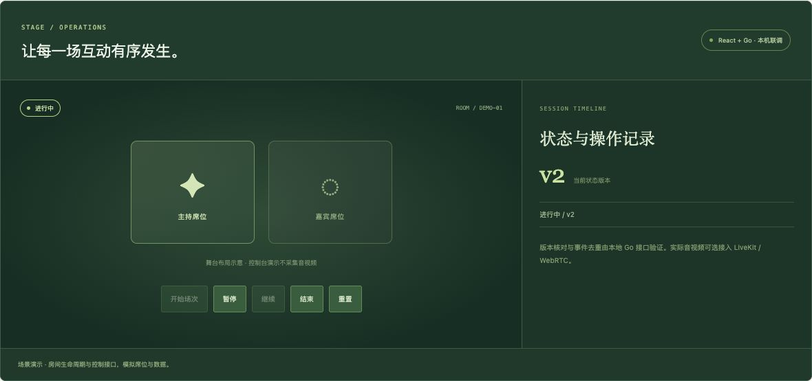
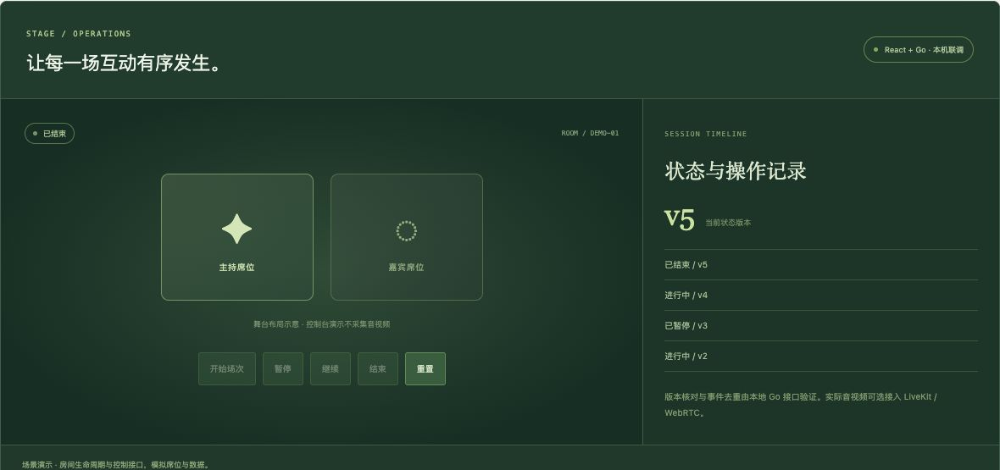
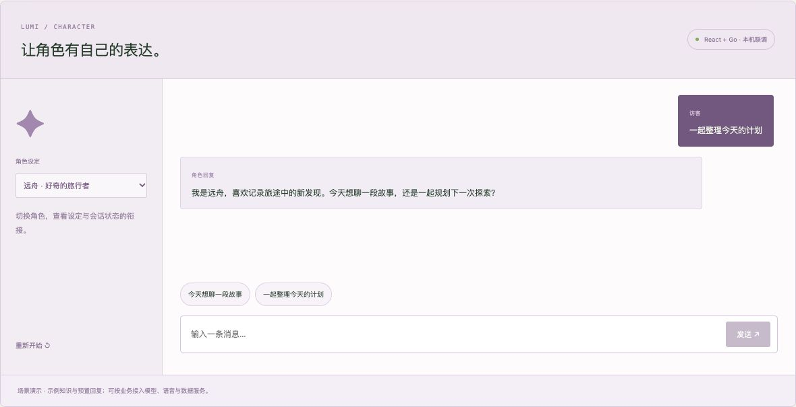
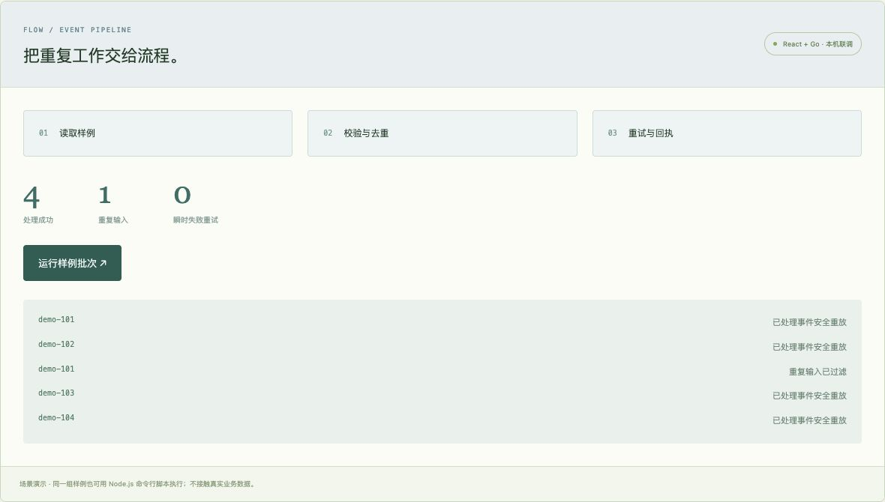

# Interaction Workbench

Four runnable scenario views built with **React, Go and Node.js**, using simulated data. Explore customer support, character conversations, live-room control and repeatable event workflows.

## Run locally

Requirements: Node.js 18.20+ and Go 1.23+. Verified locally with Node.js 18.20.1 and Go 1.23.3.

```sh
npm ci
npm run dev
```

Open **http://localhost:4322/** after the local API is ready. The UI and API listen on loopback only. The development runner starts the Go API when needed and reuses an existing matching fixture service.

## Try the core flows

- **Knowledge support:** choose an order or billing prompt → the React client receives streamed Go NDJSON events → inspect the sample knowledge citation. An unmatched request enters the human-handoff branch.
- **Character conversation:** select either sample persona → send a message → review the fixture response. Switching persona resets the session.
- **Live-room control:** start → pause → resume → end. The Go service validates transitions and expected versions, and replays repeated event IDs safely. The stage view represents seats; media transport can be integrated separately.
- **Event job:** run five JSON fixtures → validate → filter duplicate input → process four unique events → retry one simulated transient failure → inspect receipts. Repeating the same batch verifies safe replay.

中文：知识客服、角色对话、直播控制与事件任务均有可操作界面。点击问题、切换角色、操作场次或运行样例批次，即可查看业务状态与接口结果。

## Running screenshots

These images were captured from the running local React + Go demo, using its fixture data.

### Knowledge matching and handoff




### Live-room lifecycle




### Character session and event receipts




## Tests and repeatable verification

```sh
npm test
npm run test:api
npm run build
```

The Go tests cover streamed events, knowledge routing, invalid inputs, lifecycle transitions, version conflicts, event-payload conflicts, concurrent deduplication, origin restrictions and body limits. Node tests cover fixture validation, semantic duplicate detection, conflicts and the local-only job endpoint.

With the API running:

```sh
npm run demo:job
npm run demo:job
```

From clean memory, the first run accepts four unique events, filters one duplicate input and records one transient retry. The next run returns duplicate receipts without accepting more events. See the actual saved [first-run receipt](docs/verification/first-run.json) and [replay receipt](docs/verification/replay-run.json). Restarting the API clears in-memory state. The screenshot shows a replay run; the JSON receipts separately preserve the initial-retry verification.

## Architecture

- `web/scene.jsx`: React scenario views, user input, streaming reader and state feedback.
- `services/api/main.go`: Go standard-library HTTP service, input validation, NDJSON streams, room state and idempotent event handling.
- `services/api/fixtures.json`: shared synthetic knowledge, personas and event inputs.
- `scripts/run-demo-job.mjs`: Node.js validation, deduplication, bounded retry and receipts.
- `scripts/dev.mjs`: loopback UI server and local API proxy.

### API

- `GET /demo-api/health`
- `POST /demo-api/chat`
- `GET /demo-api/room` and `POST /demo-api/room`
- `POST /demo-api/events`

The UI port is 4322 and API port is 4738. The API uses memory rather than durable storage. To run only the API, use `npm run dev:api`.

## Scope and integrations

This repository contains independently created scenario demos. Knowledge and character replies use deterministic fixtures. Model APIs, voice, WebRTC transport, recording, production identity and storage are integration options, with the boundaries visible in code. Asset-related fixture events are notifications only; no wallet, chain transaction or financial action is performed.

Only demo source, synthetic fixtures and real running screenshots are included. No customer source code, private project data, credentials or local caches are published. Dependencies are pinned in the lockfile; upstream notices are in [THIRD_PARTY_NOTICES.md](THIRD_PARTY_NOTICES.md).

**场景演示 Demo，使用模拟数据。**
